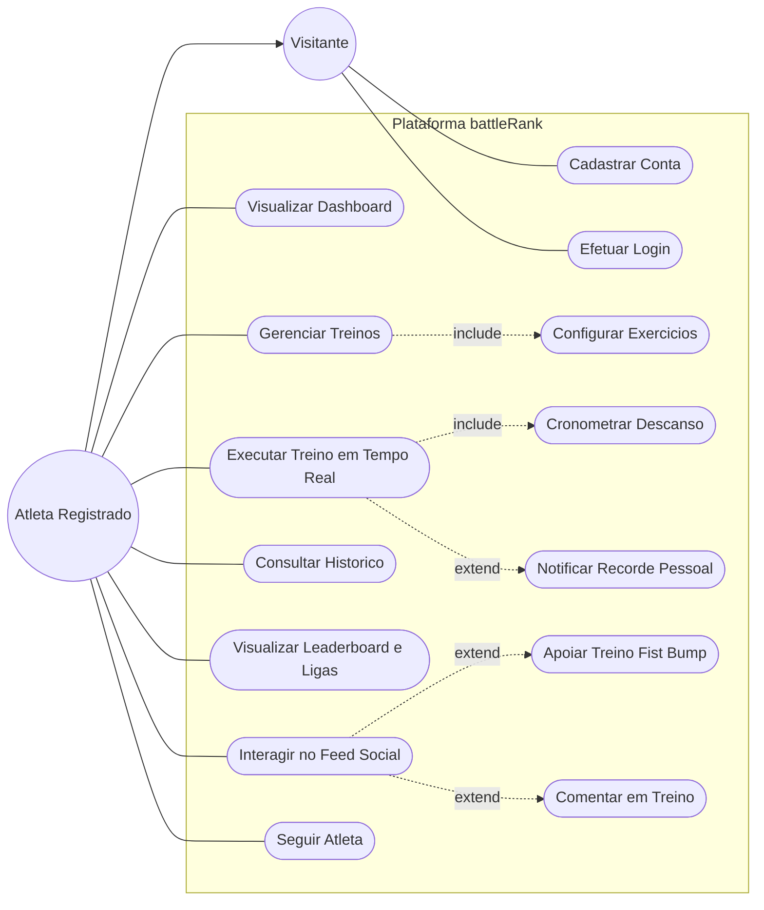
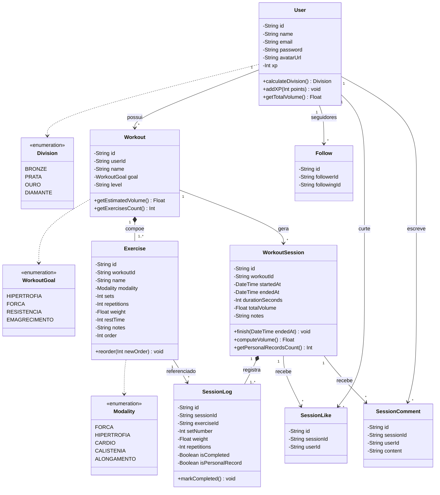
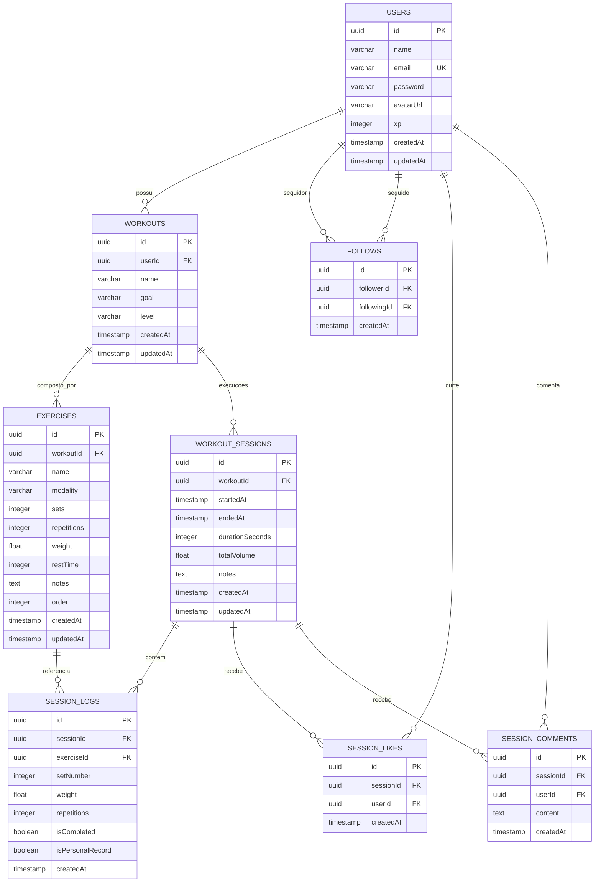

# PROJETO DE SOFTWARE • ENTREGA ACADÊMICA (UNIVERSIDADE IMPACTA)
## battleRank — Plataforma Fitness Social
### Documentação Técnica e Resumo das Funcionalidades Implementadas na Prova Final

---

## 📌 Visão Geral
O **battleRank** é uma plataforma fitness social inspirada no Strava e no Hevy voltada à criação de fichas de treino, registro de cargas, acompanhamento de evolução física e competição saudável entre atletas.

---

## 1. Identificação do Aluno e da Disciplina

| Campo | Detalhe |
| :--- | :--- |
| **Disciplina** | Projeto de Software |
| **Professor** | Antônio |
| **Atividade** | **Prova Final — Entrega Completa** |
| **Aluno** | **Lucas Fernandes Luz** |
| **RA** | **2301422** |
| **Responsabilidade** | Full Stack / Arquitetura |

---

## 2. Links Oficiais da Entrega (Prova Final)

| Artefato / Recurso | Endereço (URL) |
| :--- | :--- |
| **Repositório no GitHub** | [https://github.com/LucasFLuz/battleRank](https://github.com/LucasFLuz/battleRank) |
| **Board do Projeto (Kanban)** | [https://github.com/users/LucasFLuz/projects/1](https://github.com/users/LucasFLuz/projects/1) |
| **Vídeo Demonstrativo (Prova Final)** | [https://youtu.be/eUC4TpJ2kiI](https://youtu.be/eUC4TpJ2kiI) |

> **Escopo da Prova Final Entregue:** Sistema completo de amizades e seguidores (Follow), feed social público de atividades com interações em tempo real (curtidas Fist Bump 👊 e comentários), gamificação por pontuação (XP) com Leaderboard/rankings divididos em ligas (Bronze, Prata, Ouro e Diamante), e dashboard analítico de progressão com gráfico semanal de sobrecarga.

---

## 3. Planejamento Evolutivo (Roadmap das Sprints)

| Etapa | Status | Escopo Entregue |
| :--- | :---: | :--- |
| **AC1** | Concluído | Fundação da arquitetura em 3 camadas, modelagem inicial no PostgreSQL, API Express + Prisma e interface web dinâmica em React + TailwindCSS. |
| **AC2** | Concluído | Cadastro de Exercícios vinculado a treinos com séries, repetições e cargas alvo, modo de execução em tempo real (Live Workout), cronômetro de descanso e histórico de PRs. |
| **AC3** | Concluído | Autenticação completa de usuários via token JWT, rotas protegidas no backend e frontend, e isolamento rigoroso de treinos e históricos por atleta. |
| **Prova Final** | Concluído | Sistema social completo (seguir atletas, feed com Fist Bumps e comentários), rankings por liga/XP, pódio top 3 e dashboard com análise de volume semanal. |

---

## 4. Modelagem e Diagramas do Sistema

### 4.1. Diagrama de Casos de Uso (UML)

- **Herança de Atores:** O *Atleta* herda todas as ações do *Visitante* e adiciona as operações logadas.
- **include:** Executar treino inclui obrigatoriamente a cronometragem de descanso entre séries.
- **extend:** Bater Recorde Pessoal (PR) e interações no feed (curtir/comentar) são extensões de fluxo.

---

### 4.2. Diagrama de Classes de Domínio (UML)

---

### 4.3. Modelo Entidade-Relacionamento (MER / DER)

---
*battleRank • Projeto de Software (Prova Final) — Lucas Fernandes Luz (RA: 2301422)*
